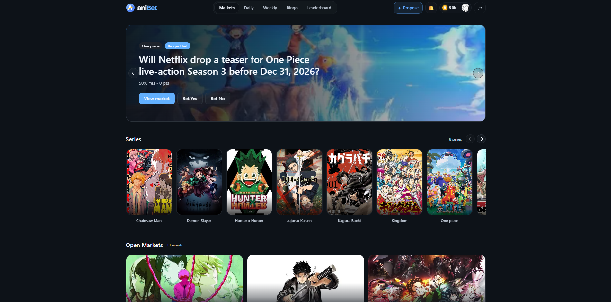
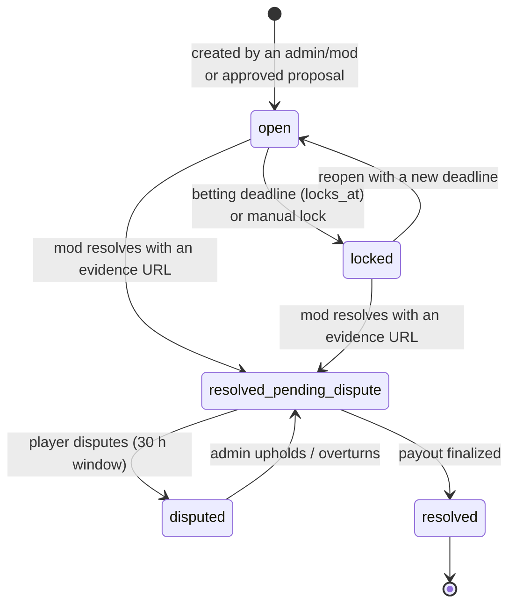
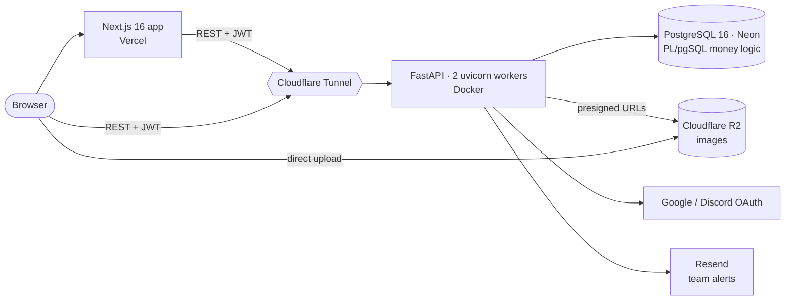

<p align="center">
  
</p>

<h1 align="center">aniBet</h1>

<p align="center">
  <strong>Community-driven prediction markets for anime &amp; manga.</strong><br>
  Bet play-money AniCoins on fights, deaths and plot twists, play daily puzzles, and climb seasonal leaderboards.
</p>

<p align="center">
  <a href="https://github.com/loickballoy/aniBet/actions/workflows/ci.yml"></a>
  
  
  
  <a href="LICENSE"></a>
</p>

---

aniBet is a full-stack web app where fans predict what happens next in the series they follow. Each question ("Who wins the fight in chapter 1197?") is a **pari-mutuel market**: players stake AniCoins on an outcome, and when the market resolves the winners split the pool. Community members propose new markets, per-series moderators approve and resolve them, and any player can dispute a resolution with evidence.

AniCoins are play money: nothing is bought or cashed out. The project is built like a real money system all the same: balances only move inside database transactions, every movement is written to a ledger, and payouts are idempotent.



## Contents

- [Features](#features)
- [How a market works](#how-a-market-works)
- [Architecture](#architecture)
- [Engineering highlights](#engineering-highlights)
- [Tech stack](#tech-stack)
- [Repository layout](#repository-layout)
- [Getting started](#getting-started)
- [Testing & CI](#testing--ci)
- [Deployment](#deployment)
- [Roadmap](#roadmap)
- [License](#license)

## Features

**For players**
- **Prediction markets** with live odds, a "closing soon" feed, link previews generated per market, and one-click sharing.
- **Daily games:**
  - Trivia (Mon/Wed/Fri/Sun), generated automatically from a curated question bank.
  - Character silhouette guessing, scheduled by admins on the other days.
  - A weekly *AniConnections* puzzle (find 4 groups of 4).
  - Rewards in AniCoins, plus a daily streak.
- **Guest play:** anyone can play the daily games without an account. Guests never receive the answer key, so it can't be used to farm rewards.
- **Bingo cards** per chapter, **seasons** with tiers (Iron → Diamond) and a Hall of Fame, and a friends leaderboard (follow other players).
- **Onboarding starter quest** and an in-app notification center (bet results, proposal reviews).

**For the community**
- Anyone can **propose a market** or a new series. Approved proposers earn a bonus and 0.5% of their market's pool at payout, taken from the house fee.
- **Per-series moderators** review proposals, lock/reopen and resolve markets. Mods cannot bet in their own series.
- **Disputes:** any player can challenge a resolution with counter-evidence during a 30-hour window. An admin then upholds or overturns it.

**For admins**
- A control panel for the following:
  - markets, series, bingo cards, daily/weekly puzzles, moderators and disputes
  - a **growth dashboard**: guest→signup conversion, first bet within 24h, D7 retention, streaks, and the community share of markets

## How a market works



Payouts are pari-mutuel: each winning bet receives its share of the whole pool minus the market fee (2% by default, bounded to 0–20%):

```
payout = ⌊ stake / winning_pool × total_pool × (1 − fee) ⌋
```

The proposer's 0.5% cut comes out of that fee, so the coins paid out never exceed the coins staked.

## Architecture



- **Frontend:** Next.js App Router. Market pages are server-rendered, so they are indexable and come with Open Graph images. The games and dashboards are client components.
- **Backend:** a stateless FastAPI service with no ORM. Routes validate input with Pydantic and call small `utils` modules that run parameterized SQL through a `psycopg` 3 connection pool.
- **Database:** everything that moves coins (placing a bet, resolving, paying out, disputes, game rewards, quest claims) is a **PL/pgSQL function** in [`backend/migrations/`](backend/migrations). Each one runs in a single transaction and takes row locks.
- **Network:** in production the API has no public port. It's reachable only through a Cloudflare Tunnel, which also provides the client IP used for rate limiting.
- **Images:** uploaded straight from the browser to R2 through short-lived presigned URLs, so they never transit through the API.

## Engineering highlights

- **Integrity lives in the database.** Bet placement, payouts and dispute resolution are SQL functions using `SELECT … FOR UPDATE`. Two concurrent requests can't double-spend a balance or pay a market twice. Every credit and debit is written to a `point_transactions` ledger. That ledger also feeds seasonal rankings and the profile history.
- **Idempotent side effects.** Paying the proposer's cut is guarded by the ledger, so running it twice pays once. Quest rewards are guarded by a composite primary key. Trivia generation uses `INSERT … ON CONFLICT DO NOTHING` with a date-seeded RNG, so concurrent workers produce the same puzzle.
- **Answers never reach the client early.** Puzzle tables split public `content` from a private `answer` column that no public route returns. Logged-in players see the answer only after their attempt is concluded.
- **Auth:**
  - Typed JWTs with rotation: an access token can't be used as a refresh token, and vice versa.
  - Passwords hashed with bcrypt.
  - Google and Discord OAuth. Tokens are returned in the URL fragment, so they never land in server logs.
  - A verified OAuth email takes over any unverified password account using the same address, which blocks account pre-hijacking.
  - Banned accounts are refused on every request.
- **Defense in depth:**
  - Signup accepts an explicit allow-list of fields (no mass assignment).
  - Per-IP rate limits on login, signup and guest games.
  - Bounded pagination and market fees.
  - Avatar URLs restricted to the upload bucket.
  - Swagger/OpenAPI disabled in production.
  - Security headers on the frontend.
- **Test isolation by construction.** The suite refuses to start unless `DATABASE_URL` points to a database named `anibet_test`. It recreates that database and replays every migration on each run.

## Tech stack

| Layer | Technologies |
|---|---|
| Frontend | Next.js 16 (App Router), React 19, TypeScript, Tailwind CSS 4, shadcn/ui, Embla Carousel, `next/og` |
| Backend | Python 3.12, FastAPI, Pydantic 2, psycopg 3 (connection pool), python-jose (JWT), bcrypt, Authlib (OAuth), boto3 (R2) |
| Database | PostgreSQL 16 (Neon in production), plain SQL migrations, PL/pgSQL |
| Infrastructure | Docker Compose, Cloudflare Tunnel, Cloudflare R2, Vercel, Resend |
| Quality | pytest (126 tests), GitHub Actions (pytest against Postgres 16 + `tsc --noEmit`) |

## Repository layout

```
aniBet/
├── backend/
│   ├── app/
│   │   ├── routes/        # FastAPI routers: auth, events, bets, daily, weekly, bingo, moderation, seasons, growth…
│   │   ├── utils/         # business logic + SQL (one module per domain)
│   │   ├── models/        # Pydantic request/response models
│   │   └── data/          # trivia question bank (JSON)
│   ├── migrations/        # 001…018: schema + PL/pgSQL functions, replayed in order
│   ├── tests/             # pytest suite (ordered, end-to-end against a real Postgres)
│   ├── docker-compose.yml       # dev: Postgres, API with live reload, Adminer, test report server
│   └── docker-compose.prod.yml  # prod: API (2 workers) + Cloudflare Tunnel
├── frontend/web/
│   └── src/
│       ├── app/           # App Router pages (markets, daily, weekly, bingo, leaderboard, admin, mod…)
│       ├── components/    # UI components, admin control panel
│       └── lib/           # API helpers, sharing, guest progress
└── docs/GROWTH_PLAN.md    # product roadmap for user acquisition
```

## Getting started

**Prerequisites:** Docker with Docker Compose, Node.js 22, and a Google and a Discord OAuth app (any values work for local API testing, but real ones are needed to log in with them).

### 1. Backend + database

```bash
cd backend
cp .env.example .env          # fill in the values (see the table below)
docker compose up --build
```

| Service | URL |
|---|---|
| API | http://localhost:5000 (interactive docs at `/docs`) |
| Adminer (database UI) | http://localhost:8081 |
| Test report | http://localhost:8082/report.html |

All migrations run automatically the first time the Postgres volume is created. To apply a **new** migration to an existing database without resetting it:

```bash
docker compose exec -T db psql -U anibet -d anibet < migrations/0XX_name.sql
```

### 2. Frontend

```bash
cd frontend/web
cp .env.example .env.local    # NEXT_PUBLIC_API_URL=http://localhost:5000
npm ci
npm run dev                   # http://localhost:3000
```

### 3. Make yourself an admin

Sign up on the site, then:

```bash
docker compose exec db psql -U anibet -d anibet \
  -c "UPDATE \"User\" SET role = 'admin' WHERE username = '<your-username>';"
```

### Environment variables

**Backend** (`backend/.env`):

| Variable | Required | Purpose |
|---|---|---|
| `DATABASE_URL` | yes | Postgres connection string (overridden by Docker Compose in dev) |
| `SECRET_KEY`, `SESSION_SECRET_KEY` | yes | JWT signing and OAuth session cookies. Use long random values |
| `FRONTEND_URL` | yes | CORS origin and OAuth redirect target |
| `GOOGLE_CLIENT_ID`, `GOOGLE_CLIENT_SECRET`, `GOOGLE_REDIRECT_URI` | yes | Google OAuth |
| `DISCORD_CLIENT_ID`, `DISCORD_CLIENT_SECRET`, `DISCORD_REDIRECT_URI` | yes | Discord OAuth |
| `CLOUDFLARE_ACCOUNT_ID`, `CLOUDFLARE_ACCESS_KEY_ID`, `CLOUDFLARE_SECRET_ACCESS_KEY`, `CLOUDFLARE_BUCKET_NAME`, `CLOUDFLARE_PUBLIC_URI` | for uploads | R2 bucket for images |
| `RESEND_API_KEY`, `NOTIFY_EMAIL`, `EMAIL_FROM` | no | Team email alerts (proposals, disputes). Without a key, no email is sent |
| `ENV` | no | `production` hides the Swagger/OpenAPI docs |
| `EXTRA_CORS_ORIGINS` | no | Comma-separated extra allowed origins |

**Frontend** (`frontend/web/.env.local`):

| Variable | Purpose |
|---|---|
| `NEXT_PUBLIC_API_URL` | Base URL of the API |
| `NEXT_PUBLIC_SITE_URL` | Public URL of the site, used for absolute links in previews and the sitemap |

## Testing & CI

The backend suite runs end-to-end against a real PostgreSQL database. It covers auth and security, series, events, betting and payouts, moderation and disputes, bingo, seasons, daily and weekly games, guest play, trivia scheduling and growth features.

```bash
# with `docker compose up` running
docker compose exec -e DATABASE_URL=postgresql://anibet:anibet_dev_only@db:5432/anibet_test \
  backend python -m pytest tests/ -v
```

Details are in [`backend/tests/README.md`](backend/tests/README.md). On every push to `main` and every pull request, [GitHub Actions](.github/workflows/ci.yml) runs the following:
- the backend suite against a Postgres 16 service;
- a TypeScript type check of the frontend.

## Deployment

| Component | Where | How |
|---|---|---|
| Frontend | Vercel | Builds from `frontend/web` on push |
| API | Docker host | `docker compose -f docker-compose.prod.yml up -d --build`, behind a Cloudflare Tunnel (no open port) |
| Database | Neon (PostgreSQL 16) | New migrations are applied by running the new `.sql` file once (SQL editor or `psql`) |
| Backups | Docker host | [`backup.sh`](backend/backup.sh) takes a daily `pg_dump` and keeps it for 30 days |

## Roadmap

User acquisition and engagement work is tracked in [`docs/GROWTH_PLAN.md`](docs/GROWTH_PLAN.md).

## License

[MIT](LICENSE) © 2026 Loïck Balloy. aniBet is a fan project, not affiliated with any publisher or studio. Series names belong to their respective owners.
